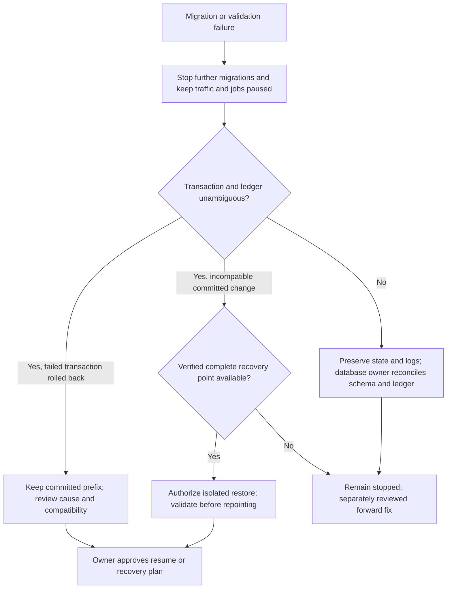

# Database recovery and rollback — WS3

**PROCEDURE, NOT AUTHORIZATION.** No hosted backup/restore or repointing was attempted. Source: [OPERATIONS.md](OPERATIONS.md), [migration map](MIGRATION_DEPENDENCY_MAP.md), `scripts/check-rollout-rehearsal.mjs`.

## Backup acceptance

Before a future rollout, the database owner must name source and isolated recovery destination, authorize each read/write, establish approved encrypted storage/access/retention, record schema/app revisions and migration file hashes, and set numerical RPO/RTO. Those objectives are UNSET, not zero. No PITR or infrastructure provisioning is authorized; paid recovery features require D8 and exact action approval.

Inventory the complete recovery scope: application tables/data, schema, functions, triggers, indexes, constraints, RLS, ownership, effective grants and default privileges, ledger, Auth identities/configuration, Storage metadata AND actual objects, extensions/versions, sequences, platform dependencies, secrets/configuration held outside the dump, and encryption-key recovery. Logical database dumps do not back up object-storage payloads or all project settings. Never export secrets to repository artifacts; access to backup data itself requires privacy authorization.

Take a consistent backup under an approved quiescence/snapshot plan. Record recovery-point timestamp and all writes after it; verify SHA-256 manifest, archive readability and scope. Inspect a restore TOC before execution; no generic --clean on a real target. A matching checksum proves file integrity, not restorability. Restore onto a separately authorized isolated destination with matching platform/extension prerequisites; retain grants and ownership, and review any platform-owned exclusions individually. Do not globally use --no-acl/--no-owner to force success.

**VERIFIED_LOCAL (disposable DB, limited):** The original restore reproduced client privilege drift (TRUNCATE 72→82; REFERENCES/TRIGGER 144→164) despite successful pg_restore and matching sampled data. Closeout keeps that unsafe scenario as a required negative test. `scripts/recovery-security.mjs` replaces nondeterministic string_agg ORDER BY 1 with explicit stable category/object/principal/privilege ordering. Ownership/RLS flags, normalized ACLs (grantor/grantee/privilege/grant-option), effective client/service rights (including inherited/PUBLIC), and each creator's global/public default ACLs are compared separately. Function signatures include schema and identity arguments; sequences use sequence ACL defaults, not table defaults. Repeated snapshots must match.

### Verified isolated restore mitigation

Root cause: PostgreSQL applies destination creator defaults to newly restored objects. pg_dump ACL output assumes PostgreSQL's hardwired object-creation ACL baseline, not arbitrary Supabase defaults; destination-only grants may survive. Public-schema defaults ADD to global defaults. Simply making the function-creation baseline deny PUBLIC is also incorrect: source functions with NULL proacl can intentionally retain hardwired PUBLIC EXECUTE, and their dump has no grant to reintroduce it.

The rehearsal therefore does the following ONLY in a newly created, isolated target of the same cached image. It accepts no target URL. This is a tested local method, NOT a general hosted restore script:

1. Capture source schema/security snapshots and postgres global/public defaults, and target supabase_admin defaults. Record extension versions and creation conditions.
2. Pre-create vector and btree_gist under the original fresh-image conditions, reproducing extension-member ACLs (schema-filtered pg_dump does not restore those members). Verify extension placement/version and final snapshots; do not assume another image/configuration matches.
3. For the restoring creator postgres ONLY, neutralize custom non-owner defaults in global/public table, sequence and function scopes, restoring the **hardwired** creation baseline (owner rights; PUBLIC EXECUTE on functions). Do not revoke actual existing platform-object grants, modify role memberships, or change supabase_admin defaults. The explicit source dump revokes PUBLIC on restricted functions.
4. Restore with --exit-on-error and the reviewed TOC. Exclude exactly CREATE SCHEMA public (already present, owned by pg_database_owner) and supabase_admin default ACL entries (postgres cannot alter those); those platform defaults are independently checked unchanged. Retain all application object ACLs, owners and postgres default entries. Failure copying the dump/list, pg_restore failure or missing comparison evidence fails acceptance.
5. After object restoration, neutralize postgres custom defaults again, clear the temporary hardwired global PUBLIC function default, and replay the captured source creator defaults, including global absence semantics. This affects future objects only; it does not repair object grants by broadening clients.
6. Require schema definitions (columns/types/defaults, functions, triggers, constraints, indexes, policies), ownership/RLS flags, ACLs, effective table/sequence/function privileges and creator defaults to match source. Check TRUNCATE, sequences and function EXECUTE explicitly, stable repeated output, unchanged platform creator defaults, identical preflight and sampled data fingerprints. A successful pg_restore with any mismatch is rejected. Upgrade the restored copy and compare schema/security again.

DDL comparison reparses CHECK expressions through PostgreSQL on temporary LIKE tables: pg_dump can flatten nested AND parse trees without changing logic. No regex strips predicates or parentheses. A negative AND-versus-OR test must still differ; names, validation flags and every predicate remain compared. Temp comparison objects disappear at session end.

The mitigation passes the normalized security regression locally; see the final executed counts in [WS3 report](WORKSTREAM_3_REPORT.md). No original assertion was weakened. A deliberately failed restore status and missing evidence are rejected even with otherwise identical snapshots. The broader real-role/production-governance suites run independently in `scripts/check-offline-database.mjs` on a newly created network-none database and PostgREST namespace.

| Recovery dimension | Local evidence | Real-target requirement |
|---|---|---|
| Data | Sampled business/document/FAQ/chunk/calendar fingerprints | Complete approved data scope, counts/hashes and point-in-time reconciliation |
| Schema | Deterministic definition comparison before and after roll-forward | Full actual target/platform schema comparison |
| Security | Owners, ACLs, effective rights, RLS flags/policies and defaults | Target role hierarchy, extension differences and every owner/creator reviewed |
| Isolation | New cross-tenant write denied; independent real-role/HTTP suites | Actual hosted Auth sessions, claims and denial tests |
| Knowledge | Draft retry preserves identity/provenance; approval/retrieval/scope checked | Authorized target inventory, verified 0035 installation, facts and actual indexing route |
| Application | Source-based compatibility and independent production-provider test path | Matching artifact, runtime smoke tests and cutover acceptance |

The local drill omits real Auth/Storage data/configuration, encrypted credential recovery and complete per-table fingerprints. It cannot establish hosted RPO/RTO or backup coverage. The temporary dump is removed with the owned containers. The repository recovery bundle is a CODE backup, not a database backup. All hosted restores/repointing remain separately approval-gated.

## Stop and recovery decision tree

Only a future authorized operator may pause ingress, schedulers, webhook processing, gateway/worker or retention jobs. Preserve evidence and prevent new writes during recovery. Outbound false and messaging log are necessary but do not stop database writers. Identify the committed prefix from ledger AND actual schema; connection loss after COMMIT is ambiguous until reconciled. Do not infer rollback from client exit alone or edit ledger rows to conceal divergence.

| Failure scenario | Detection | Recovery action (requires authorization) | Verification before resume |
|---|---|---|---|
| 0001 bootstrap failure | gen_random_bytes or vector operator error; partial objects/ledger | If atomic rollback proven, resolve approved D21 method on clone; otherwise preserve partial state and restore/reconcile separately | Full schema and ledger agreement, exact session/extension proof |
| Later file fails midway | nonzero SQL/runner exit or missing ledger row | Roll back active transaction; committed earlier files remain; fix only through reviewed path | No partial file objects, contiguous prefix and matching compatible app |
| Lost connection / ambiguous ledger | object/history discrepancy or uncertain commit | STOP, collect authorized catalogs and previous logs; no blind push or repair | Database owner signs reconciled state |
| App/schema mismatch | AUDIT_UNAVAILABLE, missing governance RPC or blocked writes | Keep traffic paused; choose matching schema/app pair; app rollback alone does not reverse DB | Tool fail-closed, governance/isolation smoke tests |
| Legacy pre-0035 K1 or unexpected backfill error | Old function accepts >500 in dry run but apply fails; unexpected SQL error | Require 0035 under target authorization. Corrected function quarantines >500 without source alteration; unrelated errors still roll back the call | Dry/apply reasons agree; valid mixed items progress; injected failure has zero partial work; retries idempotent |
| Index crash/partial chunks | draft incomplete/failed, expected-count mismatch | Reviewed single-draft retry, no approval until ready; no remote inference in WS3 | Chunk counts/tenant/revision match; keyword and vector coverage distinguished |
| Tenant census nonzero | generic or knowledge mismatch; orphan checks | Keep affected content/work unserved; separate owner-reviewed data correction | Zero unexplained mismatches and constraints verified; no silent relabeling |
| Restore exits 0 but security differs | ACL/RLS/defaults/function comparison fails (unsafe regression reproduced locally) | STOP; diagnose platform defaults/restore ownership and produce separately reviewed recovery method | Exact effective privileges and denial tests match reviewed baseline |
| Post-commit destructive data loss | row reconciliation, missing history/old values | Restore accepted backup to isolated target; forward SQL cannot invent deleted data | Tenant counts, data hashes, approval provenance and audit relationships |
| External work may already have occurred | unresolved action/callback IDs | Reconcile at destination under separate authorization; do not replay uncertain actions | No duplicated effects; restore cannot undo remote delivery |

## Distinct rollback mechanisms

- **Application revert:** select a compatible previously reviewed artifact; does not undo schema, knowledge approvals or data changes. Older knowledge UI direct writes may fail after 0033 even though old retrieval aliases remain governed.
- **Transaction rollback:** only uncommitted work; runner must prove ledger and SQL atomicity. Local rehearsals prove SQL transactional compatibility, not hosted CLI implementation.
- **Database restore:** recovers only backed-up scope to the chosen point; loses later writes unless explicitly reconciled. Requires isolated validation and separate repoint authorization.
- **Forward fix:** new reviewed SQL/migration; no automatic authorization follows from an incident. Historical migrations remain immutable.
- **Data reconstruction:** 0003 counts can be recomputed; 0014/0015/0022 mappings and generated 0010 tokens need original evidence; dropped 0032 audit rows and 0033 revisions/approvals cannot be recovered by reverting code. 0034 privilege/trigger reversal reopens security gaps and is not a safe rollback.

## Repoint and post-recovery checklist

Before any separately authorized cutover: confirm destination identity and restored scope; validate complete ledger/schema, constraints, sequence positions, FK/orphan census, tenant boundaries, RLS/effective ACLs/defaults/function execution, synthetic authenticated/anon/service negative tests, known knowledge publication/revocation/scope, pinned agent readiness, and schema-compatible app/gateway/worker versions. Confirm key availability without logging values. Keep automations/egress paused while reconciling since-backup writes and uncertain outcomes. Obtain database/security/operations owner sign-off, privacy owner handling approval and exact repoint authorization. Record measured recovery time and data-loss window against approved objectives; resume traffic and jobs only after activation gates. None of these real-target steps is verified by WS3.

## Final K1 integration

0035 is included in the final 35-file chain. The 70-case rehearsal deliberately upgrades only to 0034 first, reproduces the historical K1 atomic failure, then applies 0035 on source and restored copy and verifies identical schema/security plus unchanged function OID/owner/ACL. Replaying the function replacement makes no data or privilege change. Corrected dry/apply quarantine >500 references consistently, valid mixed data progresses, and the independent DB fault-injection regression still proves tenant-call atomicity for an unrelated mid-call error. An already approved publication and its revision are preserved on backfill replay. No hosted restore/backfill is authorized by these local results.
